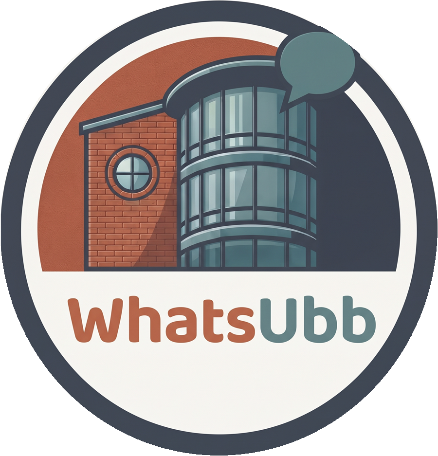
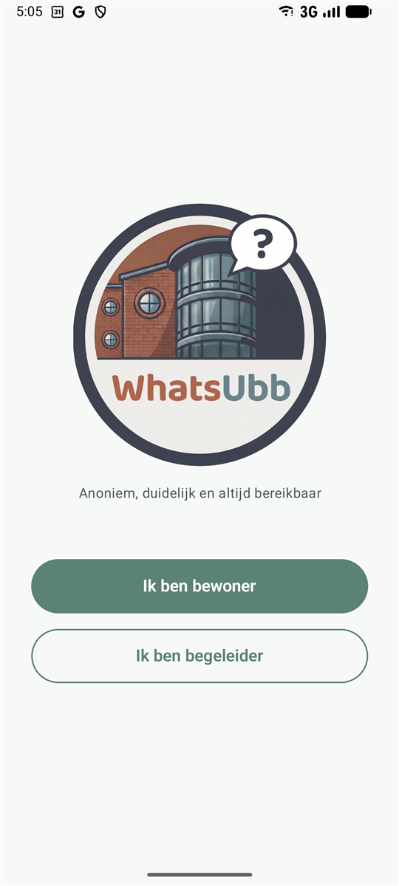
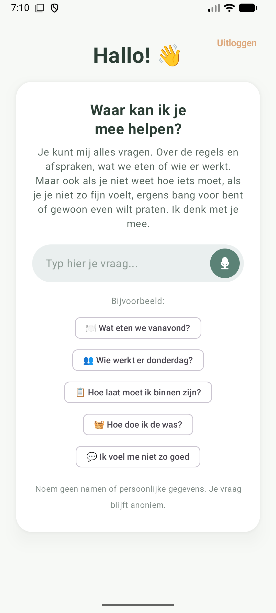
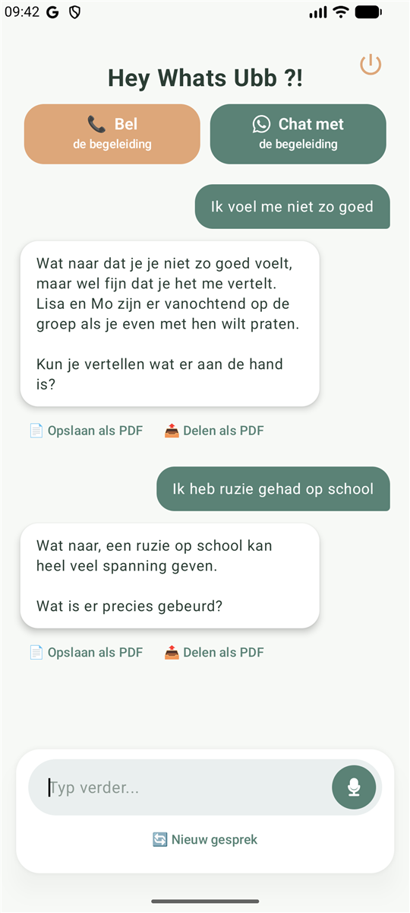
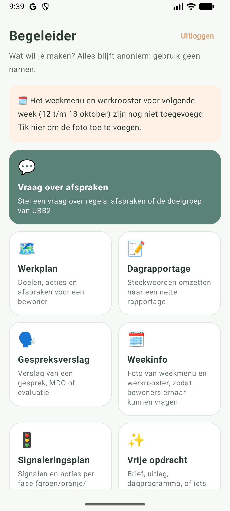
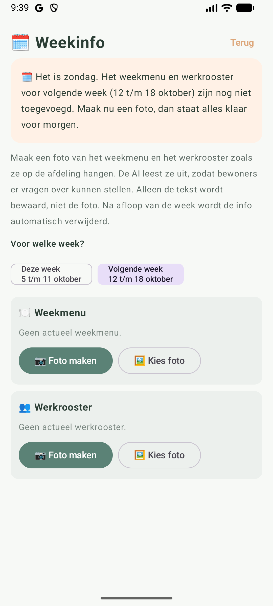
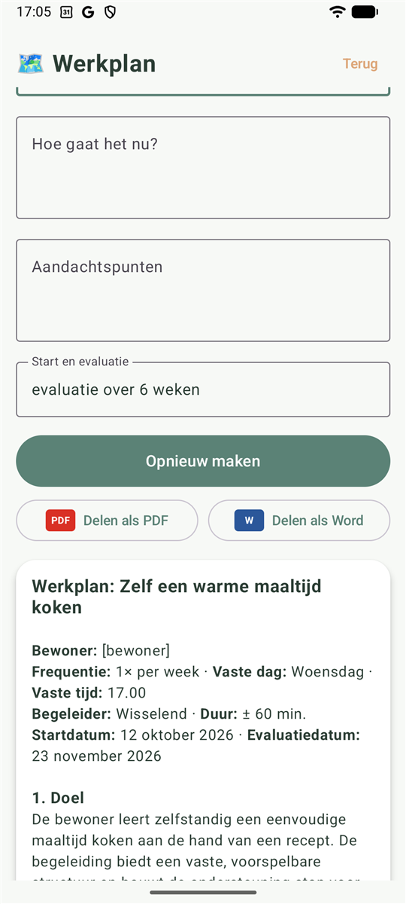
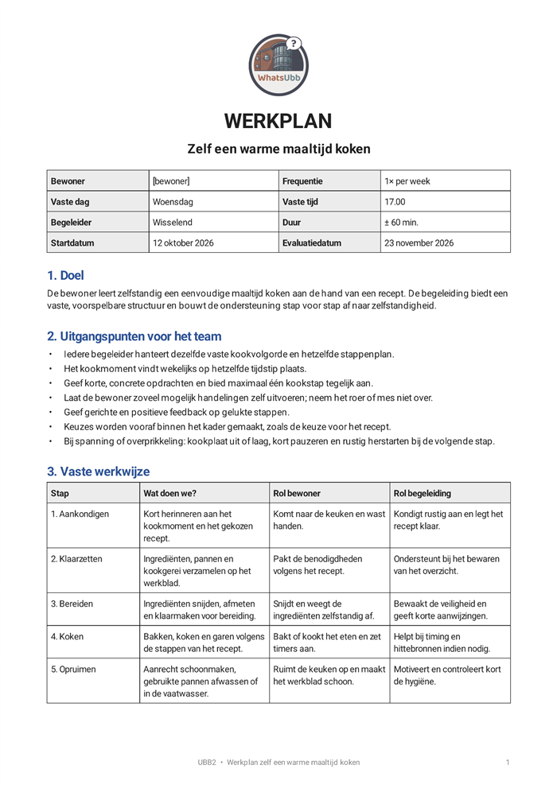
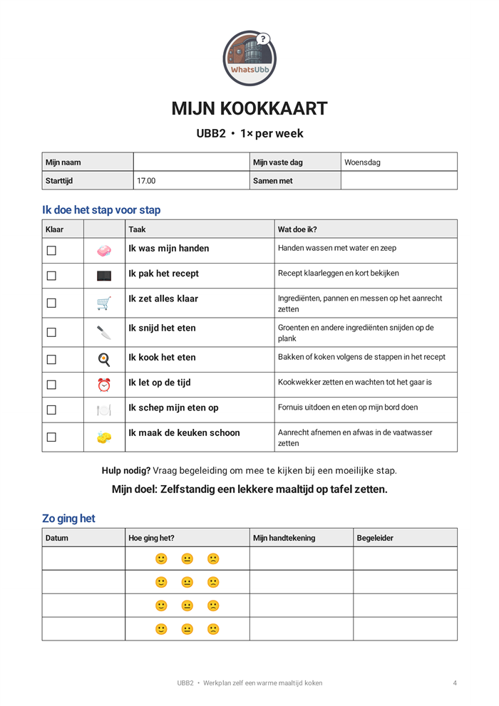
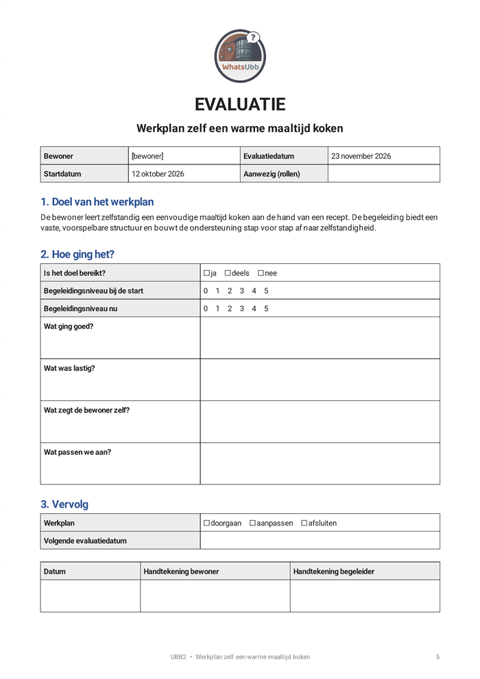

<p align="center">
  
</p>

<h1 align="center">Whats Ubb</h1>

<p align="center">
  <b>Anoniem, duidelijk en altijd bereikbaar</b><br>
  Een AI-assistent voor bewoners en begeleiders van afdeling UBB2
</p>

<p align="center">
  
  
  
  
</p>

<p align="center">
  <a href="#wat-is-whats-ubb">Wat is het?</a> ·
  <a href="#functies">Functies</a> ·
  <a href="#hoe-de-ai-werkt">Hoe de AI werkt</a> ·
  <a href="#privacy-en-veiligheid">Privacy</a> ·
  <a href="#aan-de-slag">Aan de slag</a> ·
  <a href="#voor-ontwikkelaars">Voor ontwikkelaars</a>
</p>

---

## Wat is Whats Ubb?

Whats Ubb is een Android-app voor een woonafdeling voor jongvolwassenen (18–30 jaar) met een licht verstandelijke
beperking, autisme, persoonlijkheidsproblematiek of multiproblematiek. Het doel van de afdeling is dat bewoners binnen
drie jaar zelfstandig kunnen wonen.

| Wie | Wat doet de app voor hen? |
|---|---|
| 🙋 **Bewoners** | Alles vragen: regels en afspraken, het weekmenu, wie er werkt, hoe je iets doet, maar ook als je je niet fijn voelt of ergens bang voor bent |
| 🧑‍💼 **Begeleiders** | In een paar minuten werkplannen, rapportages en gespreksverslagen maken met de AI |
| ⚙️ **Beheerder** | Bepalen wat de AI weet: de afspraken, documenten, de werkwijze en de rol van de AI |

Alles is gebouwd rond **anonimiteit**: er worden geen namen of persoonsgegevens van bewoners opgeslagen of verstuurd.

---

## Functies

### 🙋 Voor bewoners

<table>
  <tr>
    <td align="center"><br><sub>Inloggen</sub></td>
    <td align="center"><br><sub>Welkom, bel- en chatknop</sub></td>
    <td align="center"><br><sub>Doorpraten met de AI</sub></td>
  </tr>
</table>

| Functie | Wat doet het? |
|---|---|
| 💬 **Vraag alles** | Chat in eenvoudige taal (B1) over regels, afspraken, het weekmenu, het rooster, apparaten op de afdeling, praktische dingen en gevoelens |
| 🔁 **Doorpraten** | Een gesprek zoals bij online AI-chats: het invoerveld staat onderaan, na elk antwoord staat de cursor weer klaar en je verstuurt met Enter. De AI onthoudt wat er eerder in het gesprek gezegd is. Met **🔄 Nieuw gesprek** begin je opnieuw |
| 💛 **Echt luisteren** | Bij gevoelens vraagt de AI eerst rustig door (*"Wat is er gebeurd?"*) voordat hij met tips of stappen komt. Hij noemt de begeleiding bij het eerste antwoord, als jullie stappen bedenken en af en toe in een lang gesprek, niet in elk antwoord |
| 🎙️ **Spraak** | Microfoonknop in het invoerveld: inspreken in plaats van typen |
| 👆 **Voorbeeldvragen** | Aanklikbare vragen zoals *"Wat eten we vanavond?"* en *"Ik voel me niet zo goed"* |
| 📞 **Bel- en chatknop** | Eén tik om de begeleiding te bellen of via WhatsApp te chatten; tussen 23:00 en 08:00 de bereikbare dienst (met controlevraag) |
| 📄 **Antwoord als PDF** | Elk antwoord (met de vraag erbij) opslaan of delen als PDF |
| 🆘 **Veilig** | Bij crisis verwijst de AI naar de begeleiding, de bereikbare dienst, 112 of 113, afhankelijk van het tijdstip |
| 💚 **113-knoppen** | Gaat het over somberheid of suïcidale gedachten? Dan verschijnen onder het antwoord knoppen om 113 te bellen of te chatten (gratis, anoniem, dag en nacht) |

### 🧑‍💼 Voor begeleiders

Toegang met de begeleider-PIN.

<table>
  <tr>
    <td align="center"><br><sub>Menu</sub></td>
    <td align="center"><br><sub>Weekinfo</sub></td>
    <td align="center"><br><sub>Werkplan, delen als PDF of Word</sub></td>
  </tr>
</table>

| Functie | Wat doet het? |
|---|---|
| 🗺️ **Werkplan** | Vaste aanpak voor een taak (kamer schoonmaken, koken, boodschappen, logeren...) in één vaste UBB2-stijl: wat doet het team, wat doet de bewoner, vaste volgorde, begeleidingsniveau 0-5 en eindcontrole. Met een **aftekenkaart voor de bewoner** en een **evaluatieformulier**. Delen als PDF of als Word-document (.docx) om verder te bewerken |
| 📝 **Dagrapportage** | Van steekwoorden naar een objectieve rapportage |
| 🗣️ **Gespreksverslag** | Inclusief **gesprek opnemen** en automatisch laten uitschrijven door Gemini |
| 🚦 **Signaleringsplan** | Signalen en acties per fase (groen / oranje / rood) |
| ✨ **Vrije opdracht** | Brief, uitleg, dagprogramma of iets anders |
| 🗓️ **Weekinfo** | Foto van het weekmenu en werkrooster: de AI leest ze uit zodat bewoners ernaar kunnen vragen. Ontbreekt die voor de huidige week (ma t/m zo), dan krijg je bij het inloggen een melding. Op zondag kijkt de app naar de week die morgen begint: ontbreekt daar iets, dan kom je na het inloggen direct in Weekinfo |
| 💬 **Vraag over afspraken** | Chat over regels, afspraken en de doelgroep |
| 📄 **PDF** | Elk document als A4-PDF met logo, datum en paginanummers; ook kopiëren en delen |

#### Voorbeeld: werkplan als PDF

Een werkplan bestaat uit drie delen: het werkplan voor het team, een aftekenkaart voor de bewoner en een
evaluatieformulier. [Hele PDF bekijken](docs/voorbeelden/werkplan-koken.pdf)

<table>
  <tr>
    <td align="center"><br><sub>Werkplan voor het team</sub></td>
    <td align="center"><br><sub>Aftekenkaart voor de bewoner</sub></td>
    <td align="center"><br><sub>Evaluatieformulier</sub></td>
  </tr>
</table>

### ⚙️ Voor de beheerder

Toegang met een aparte beheerders-PIN, via Begeleider → ⚙️ Beheer.

| Functie | Wat doet het? |
|---|---|
| 🧠 **AI-rol** | De persoonlijkheid van de AI: gedragswetenschapper, doelgroep, methodieken (Verbindend Gezag & Geweldloos Verzet, Geef me de Vijf) en aanwezigheidstijden |
| 📚 **Kennisbank** | Vrije tekst met de afspraken en informatie over de afdeling |
| 📎 **Documenten** | Regels, afspraken en werkwijze uploaden als PDF, Word (.docx) of tekst |
| 🔌 **Apparaten** | Foto van de wasmachine, droger, het koffieapparaat of de kookplaat: de AI leest de knoppen en programma's uit, zodat bewoners stap voor stap uitleg krijgen over precies dat apparaat (alleen de tekst wordt bewaard) |
| 📞 **Telefoonnummers** | 06-nummer van de begeleiding en nummer van de bereikbare dienst |
| 👤 **Voornaam** | Voornaam van de begeleider op dit toestel: het menu begroet je ermee en je kunt de AI vragen "wanneer werk ik?". Bewoners krijgen de naam nooit mee |
| 🔑 **Toegang** | Bewonerscode (optioneel), begeleider-PIN, beheerders-PIN, AI-sleutel en model |

---

## Hoe de AI werkt

Bij elke vraag stelt de app één instructie samen voor Google Gemini:

| # | Onderdeel | Inhoud | Waar in te stellen |
|---|---|---|---|
| 1 | **AI-rol** | Wie de AI is en hoe hij reageert | Beheer → AI-rol |
| 2 | **Datum en tijd** | Plus de komende 8 dagen, zodat "maandagochtend" altijd de eerstvolgende is | automatisch |
| 3 | **Privacyregels** | Nooit namen van bewoners, anoniem blijven | vast |
| 4 | **Kennisbank** | Afspraken en informatie over UBB2 | Beheer → Kennisbank |
| 5 | **Documenten** | Geüploade regels en werkwijzen | Beheer → Documenten |
| 6 | **Weekinfo** | Weekmenu en rooster van deze en volgende week | Begeleider → Weekinfo |
| 7 | **Rolinstructie** | Taal en toon voor bewoner óf begeleider | vast |

De AI is opgedragen om **alleen** op deze kennis te antwoorden en eerlijk te zeggen als hij iets niet weet,
in plaats van regels te verzinnen.

---

## Privacy en veiligheid

> [!IMPORTANT]
> De anonimisering is een vangnet, geen garantie. Schrijf altijd zonder namen, gebruik voor echt gebruik een
> **betaalde** Gemini API (bij de gratis versie mag Google ingestuurde tekst gebruiken) en stem het gebruik af met de
> privacyfunctionaris (FG) van de organisatie.

| | Wat de app doet |
|---|---|
| 🕶️ **Anonimiseren vóór verzending** | Telefoonnummers, e-mailadressen, data, adressen, postcodes, BSN, IBAN en opgegeven namen worden vervangen door `[naam]`, `[datum]` enz. |
| 🧹 **Niets bewaren** | Gesprekken en gemaakte documenten worden niet opgeslagen; na uitloggen is alles weg. Gedeelde PDF's worden bij de volgende keer delen en bij het starten van de app gewist |
| 🎙️ **Opnames** | Alleen na een toestemmingsvinkje; na het uitschrijven direct bij Google verwijderd en van het toestel gewist zodra het scherm wordt verlaten (tenzij zelf opgeslagen) |
| 📷 **Foto's** | Van weekmenu, rooster en apparaten wordt alleen de uitgelezen tekst bewaard, nooit de foto. Verlopen weken worden automatisch verwijderd |
| 🔐 **Codes** | Gehasht opgeslagen; Android-back-ups staan uit |
| 👥 **Namen** | Namen van **medewerkers** uit het rooster mag de AI noemen; namen van **bewoners** nooit |

---

## Aan de slag

### Eerste keer gebruiken

1. Tik op **Ik ben begeleider** en stel de begeleider-PIN in.
2. Open **⚙️ Beheer** en stel de beheerders-PIN in.
3. Vul de **AI-sleutel**, de **kennisbank**, de **telefoonnummers** en eventueel **documenten** in.
4. Zet via **🗓️ Weekinfo** het weekmenu en rooster van deze week klaar.
5. Voeg in **⚙️ Beheer** bij **🔌 Apparaten** foto's toe van de wasmachine, droger, het koffieapparaat en andere apparaten.

### Bekende beperkingen en ideeën

- Alle instellingen, documenten en weekinfo staan **per toestel**. Een kleine gedeelde server zou ervoor zorgen dat
  de beheerder één keer uploadt voor alle toestellen, en dat de AI-sleutel niet meer in de app hoeft.
- Opnames zijn AAC in plaats van MP3 (Android kan geen MP3 opnemen).
- Het standaardmodel is `gemini-flash-latest`; reageert dat traag, kies dan in Beheer bijvoorbeeld
  `gemini-flash-lite-latest`.

---

## Voor ontwikkelaars

### Benodigd

- [Android Studio](https://developer.android.com/studio) (met JDK 17+)
- Een Gemini API-sleutel van [Google AI Studio](https://aistudio.google.com/apikey)
- Een Android-toestel of emulator met Android 7.0 of hoger

### Bouwen

```bash
git clone https://github.com/booz1974/WhatsUbb.git
cd WhatsUbb
./gradlew assembleDebug        # APK in app/build/outputs/apk/debug/
./gradlew testDebugUnitTest    # unittests
```

### AI-sleutel instellen

Kies één van beide:

1. **In de app** — Begeleider → ⚙️ Beheer → AI-sleutel *(aanbevolen voor gedeelde toestellen)*
2. **Bij het bouwen** — voeg toe aan `local.properties` (staat in `.gitignore`):
   ```properties
   GEMINI_API_KEY=jouw_sleutel
   ```

> [!WARNING]
> Een sleutel die in de APK is ingebouwd kan eruit worden gehaald. Deel zo'n APK niet met anderen.

### Techniek

- **Kotlin** + **Jetpack Compose** (Material 3), minSdk 24, targetSdk 37
- **Google Gemini** via de REST-API (`generateContent` en de Files API) — geen extra AI-libraries
- PDF met de ingebouwde `PdfDocument`, Word-import en -export (.docx) zonder externe libraries
- Spraakherkenning via de spraakdienst van het toestel

### Projectstructuur

```
app/src/main/
├── assets/
│   ├── ai_rol.md               standaard AI-rol (prompt)
│   ├── werkplan_voorbeeld.json voorbeeld-werkplan (stijl en opbouw voor de AI)
│   └── ubb2_kennis.md          standaard kennisbank (sjabloon)
└── java/com/example/whatsubb/
    ├── MainActivity.kt         navigatie en AppServices
    ├── ai/                     GeminiClient: chat, Files API (audio, PDF, foto's)
    ├── audio/                  opnemen van gesprekken (AAC)
    ├── data/                   instellingen, kennisbank, documenten, weekinfo, apparaten, documenttypes
    ├── privacy/                Anonymizer
    ├── ui/                     Compose-schermen
    └── util/                   PDF-export (ook werkplan-opmaak), Markdown, documentimport, foto's, weken
design/                         origineel logo
docs/screenshots/               screenshots voor deze README
docs/voorbeelden/               voorbeeld-PDF's
```

---

<p align="center"><sub>Privéproject voor afdeling UBB2 · gemaakt met ❤️ en Claude Code</sub></p>
